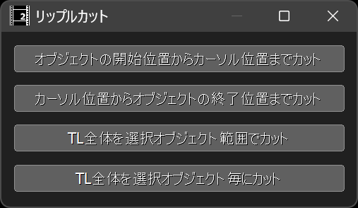
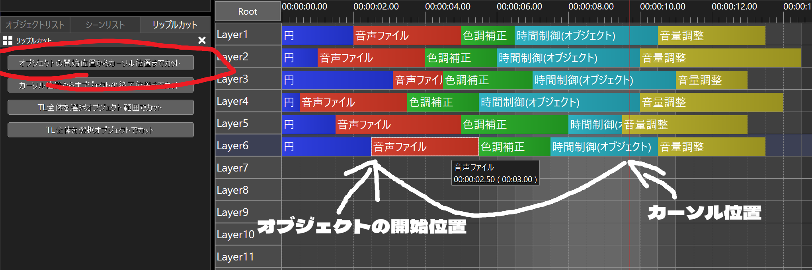
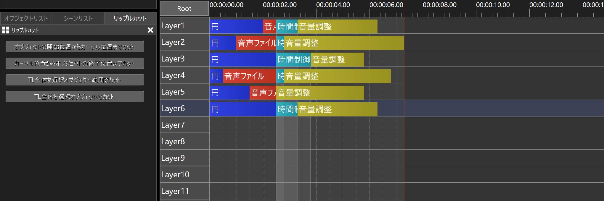
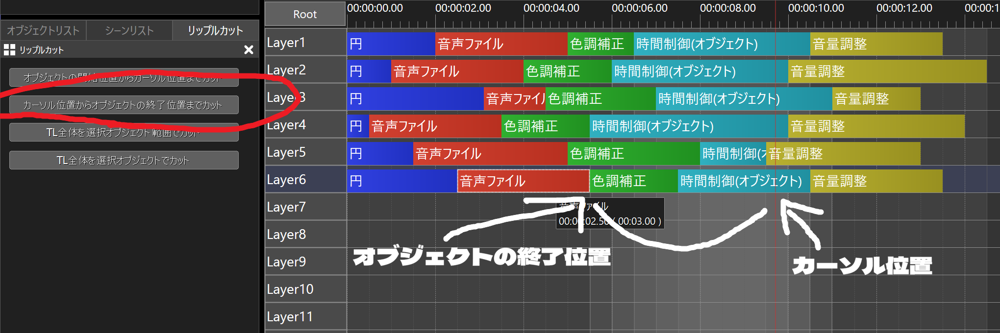
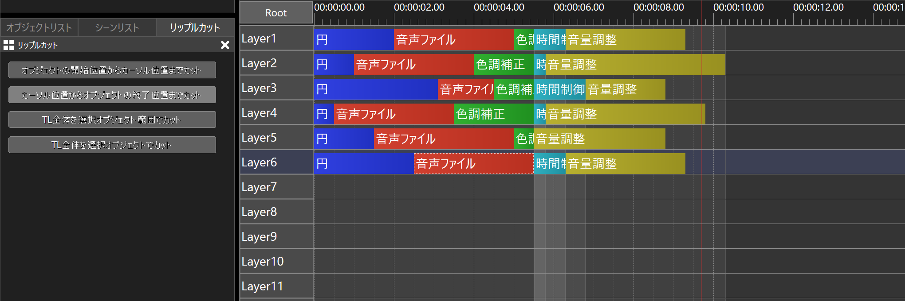
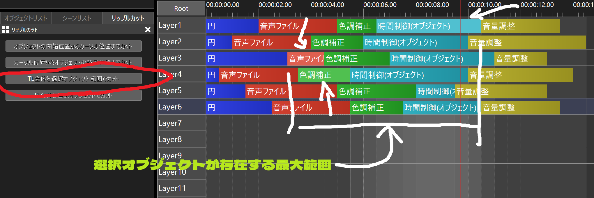
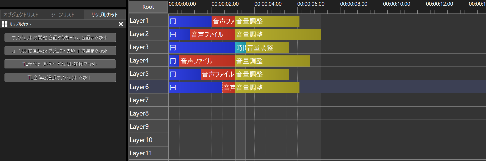
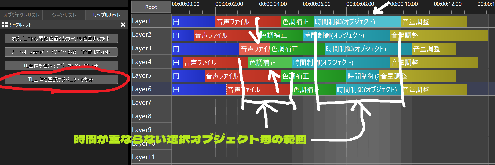
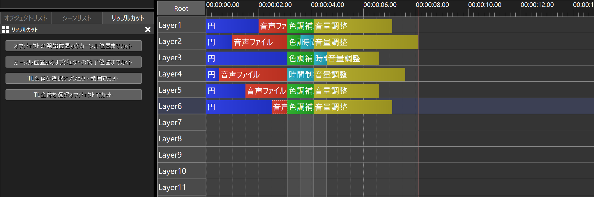

# 🐍AviUtl2 リップルカットプラグイン

* aviutl2の汎用プラグインです。
* タイムラインオブジェクトをリップルカットします。
* ここでいうリップルカットとは、「削除＆左に詰める」です。

## 🚀インストール

* `プラグインフォルダ`に以下のファイルを入れてください。
	* `al2` ✏️フォルダ
		* `al2_ripple_cutter.aux2` ✏️汎用プラグインファイル

## 🔥アンインストール

* `プラグインフォルダ`から以下のファイルを削除してください。
	* `al2` ✏️フォルダ
		* `al2_ripple_cutter.aux2` ✏️このファイルを削除
		* `al2_ripple_cutter` ✏️このフォルダを削除

## 💡使い方

1. aviutl2ウィンドウのメニューで`表示`➡`リップルカット`を選択します。
1. `リップルカット`ウィンドウが表示されます。
1. タイムラインでカーソル位置をリップルカットする位置に合わせます。
1. タイムラインでリップルカットするオブジェクトを選択またはフォーカスします。
1. `リップルカット`ウィンドウ内のボタンを押します。
1. タイムラインオブジェクトがリップルカットされます。
----
1. または、タイムラインで右クリックします。
1. コンテキストメニューが表示されます。
1. `プラグイン`➡`リップルカット`➡`(目的の項目)`を選択します。

## 🎨リップルカットウィンドウ

* `オブジェクトの開始位置からカーソル位置までカット`
	* ✏️選択オブジェクトまたは全てのオブジェクトに対して、フォーカスオブジェクトまたは選択オブジェクトの開始位置からカーソル位置までの区間をリップルカットします。
	* 一度にリップルカットする範囲は必ず1つだけになります。

実行前 

実行後 

----

* `カーソル位置からオブジェクトの終了位置までカット`
	* ✏️選択オブジェクトまたは全てのオブジェクトに対して、カーソル位置からフォーカスオブジェクトまたは選択オブジェクトの終了位置までの区間をリップルカットします。
	* 一度にリップルカットする範囲は必ず1つだけになります。

実行前 

実行後 

----

* `TL全体を選択オブジェクト範囲でカット`
	* ✏️TL全体を選択オブジェクトが存在する最大範囲でカットします。
	* aviutlにある`切り取りプラグイン`の`TLリップル`と同等の機能だと思われます。
	* 一度にリップルカットする範囲は必ず1つだけになります。

実行前 

実行後 

----

* `TL全体を選択オブジェクト毎にカット`
	* ✏️TL全体を各選択オブジェクトの範囲でカットします。
	* 一度にリップルカットする範囲が複数(時間が重ならない選択オブジェクトの数)になる場合があります。

実行前 

実行後 

## 🔖更新履歴

* 🔖r1 2026年11月09日
	* 🎉初版
